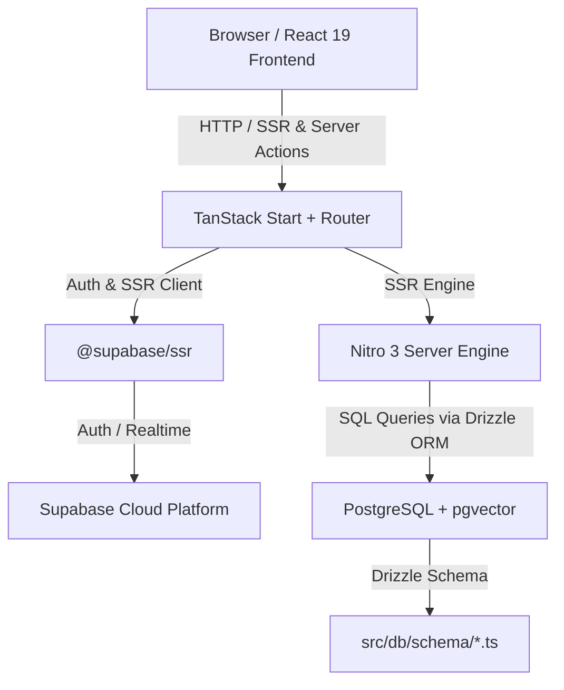

# Technology Stack & Architecture — Silex Zenith Suite

## 1. System Architecture Diagram

---

## 2. Fullstack Technology Stack Specification

| Category              | Technology               | Version               | Purpose / Description                                                              |
| :-------------------- | :----------------------- | :-------------------- | :--------------------------------------------------------------------------------- |
| **Framework**         | **TanStack Start**       | `^1.168.26`           | Fullstack SSR framework with file-based routing and server functions.              |
| **Router**            | **TanStack Router**      | `^1.170.16`           | Type-safe client & server routing system.                                          |
| **Data Fetching**     | **TanStack React Query** | `^5.101.1`            | Asynchronous state management, cache management, and server query synchronization. |
| **Frontend Core**     | **React**                | `^19.2.0`             | Next-generation React library with concurrent rendering features.                  |
| **Language**          | **TypeScript**           | `^5.8.3`              | Strict type safety across frontend UI, server routes, and DB schemas.              |
| **Build System**      | **Vite**                 | `^8.0.16`             | Lightning-fast ESM bundler with HMR and Tailwind CSS v4 integration.               |
| **Server Engine**     | **Nitro**                | `3.0.260603-beta`     | Portable JS server engine targeting Node, Serverless, and Cloudflare Workers.      |
| **Database**          | **PostgreSQL**           | Postgres 15+          | Relational database engine supporting JSONB and vector embeddings.                 |
| **AI Engine**          | **Google Gemini API**    | `gemini-3.6-flash` & `gemini-embedding-001` | Server-side AI provider engine with abstraction layer (`src/lib/ai/provider.ts`), 1536-dimensional vector embeddings (`gemini-embedding-001`), sentence-aware chunking (`src/lib/ai/chunking.ts`), vector memory ingestion (`src/lib/server-functions/ai-ingestion.ts`), read-only tool registry (`src/lib/ai/tools.ts`), Zenith query engine (`src/lib/server-functions/zenith.ts`), and `MockAIProvider` fallback. |
| **ORM**               | **Drizzle ORM**          | `^0.45.2`             | Type-safe SQL query builder with server-side runtime singleton (`src/db/index.ts`), multi-tenant workspace authorization (`requireWorkspaceAccess`), and transactional persistence across CRM, Finance, Projects, Tasks, and Dashboard (`invoices`, `clients`, `projects`, `tasks`). |
| **Event & Automation Engine** | **Domain Events & Webhook Engine** | `src/lib/events/`, `src/lib/automation/`, `src/lib/server-functions/automation.ts` | Typed domain event publisher (`publishDomainEvent`), sensitive payload sanitizer, condition evaluator (`conditions.ts`), action registry (`actions.ts`), outbox processor (`processor.ts` with `FOR UPDATE SKIP LOCKED` claims & 5m stale recovery), workflow runner (`runner.ts` with per-rule atomic `auto_run:{ruleId}:{outboxEventId}` idempotency keys), trusted actor context (`outbox_events.actor_id`), outbound webhook dispatcher (`webhooks.ts`, `dispatcher.ts` with HMAC-SHA256 signing, strict SSRF pre-flight validation, manual redirect prohibition, 10s timeout, max 2KB response truncation, 3-phase zero-lock fetch transactions, max 5 total HTTP attempts), 15 production server functions (`src/lib/server-functions/automation.ts`) for Rule CRUD, Run History, Webhook Management, and Worker Triggers (`triggerAutomationOutboxWorkerFn`, `triggerWebhookDeliveryWorkerFn` hardened with server-side `Authorization: Bearer <CRON_SECRET>` header verification & Admin/Owner session authority; public input schema strips `cronSecret`), and additive migrations `0001_outbox_m53_hardening.sql` & `0002_webhook_deliveries_m54.sql`. |
| **DB Tools**          | **Drizzle Kit**          | `^0.31.10`            | Migration runner and schema introspection toolkit (`drizzle.config.ts`).           |

| **Authentication**    | **Supabase Auth**        | `@supabase/ssr ^0.12` | Auth provider for server & client SSR cookie management.                           |
| **Styling**           | **Tailwind CSS**         | `^4.2.1`              | Utility-first CSS engine configured via `@tailwindcss/vite`.                       |
| **UI Primitives**     | **Radix UI**             | Latest (`^1.x`)       | Accessible unstyled primitives (Dialog, Dropdown, Accordion, Tooltip, Tabs).       |
| **Icons**             | **Lucide React**         | `^0.575.0`            | Comprehensive vector icon suite.                                                   |
| **Charts & Metrics**  | **Recharts**             | `^2.15.4`             | Responsive SVG charts for financial analytics and dashboard statistics.            |
| **Form Handling**     | **React Hook Form**      | `^7.71.2`             | Performant form state engine integrated with `@hookform/resolvers`.                |
| **Schema Validation** | **Zod**                  | `^3.24.2`             | TypeScript-first schema declaration and runtime input validation.                  |

---

## 3. Key Package Dependencies & Tooling

### Dev & Linting Tooling

- `eslint` (`^10.8.0`) + `@typescript-eslint` (`^8.56.1`) for strict linting rules.
- `prettier` (`^3.7.3`) for unified code formatting.
- `@lovable.dev/vite-tanstack-config` (`^2.7.7`) for Lovable local-cloud synchronization.

### Key Configuration Files

- `vite.config.ts`: Vite setup with `@tailwindcss/vite`, `tanstackRouter()`, and `tsconfigPaths()`.
- `drizzle.config.ts`: Database connection string (`DATABASE_URL`) and schema path (`./src/db/schema`).
- `tsconfig.json`: Path alias configuration (`@/*` -> `./src/*`).
