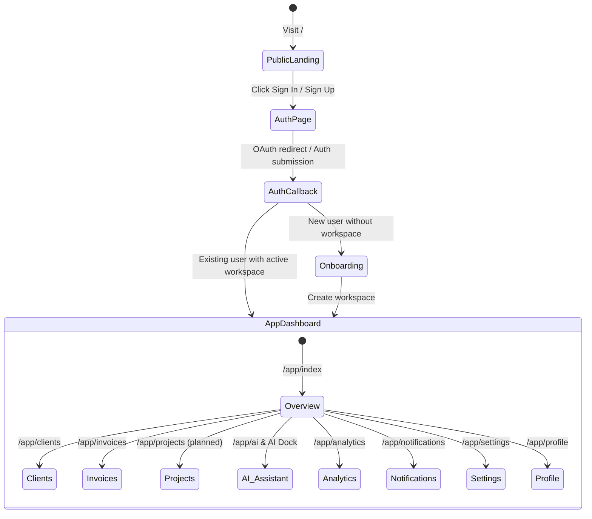

# App Flow & Navigation Map — Silex Zenith Suite

## 1. Application User Journeys & State Transitions

---

## 2. Complete Route Map & Layout Structure

All routes are located under `src/routes/` and follow TanStack Router's file-based conventions:

### 2.1. Root Layout (`src/routes/__root.tsx`)

- Configures global providers: `AuthProvider`, TanStack Query `QueryClientProvider`, Toaster (`sonner`), and root HTML head metadata.
- Handles global error boundary catching via `src/lib/error-capture.ts`.

### 2.2. Public Routes

- **`/` (`src/routes/index.tsx`)**: High-converting landing page highlighting platform features, hero section, interactive pricing table, and feature showcases.
- **`/auth` (`src/routes/auth.tsx`)**: Integrated Sign In & Sign Up tabbed view with Supabase Auth bindings (Email/Password & Social OAuth).
- **`/auth/callback` (`src/routes/auth.callback.tsx`)**: PKCE code exchange handler for OAuth session completion.

### 2.3. Onboarding Flow

- **`/onboarding` (`src/routes/onboarding.tsx`)**: Step-by-step wizard for newly authenticated users to set up their workspace name, slug, branding primary color, and default currency.

### 2.4. Protected Application Workspace (`src/routes/app.tsx` Layout Shell)

All `/app/*` routes are wrapped by `AppShell` (`src/components/silex/app-shell.tsx`) which enforces authentication checks, active workspace selection, sidebar navigation, top header bar, and the persistent **AI Zenith Dock** (`src/components/silex/ai-dock.tsx`).

| Route Path           | File Location                      | Purpose & Functionality                                                                                                                      |
| :------------------- | :--------------------------------- | :------------------------------------------------------------------------------------------------------------------------------------------- |
| `/app`               | `src/routes/app.index.tsx`         | **Main Workspace Dashboard**: KPI widgets (Revenue, Active Clients, Pending Tasks, Due Invoices), Recent Activity stream, Quick Actions.     |
| `/app/clients`       | `src/routes/app.clients.tsx`       | **CRM Client Directory**: Searchable list of clients, status badges, filter drawer, and "Add Client" modal.                                  |
| `/app/clients/$id`   | `src/routes/app.clients.$id.tsx`   | **Client Detail View**: Overview tab, contacts table, pinned client notes, active projects, and invoice history.                             |
| `/app/invoices`      | `src/routes/app.invoices.tsx`      | **Finance Invoices**: Invoice status filtering (Draft, Sent, Paid, Overdue), total revenue summary cards, invoice list.                      |
| `/app/invoices/new`  | `src/routes/app.invoices.new.tsx`  | **Invoice Creator**: Dynamic multi-line item builder, automatic subtotal/tax/discount calculations, client selector, due date picker.        |
| `/app/invoices/$id`  | `src/routes/app.invoices.$id.tsx`  | **Invoice Viewer**: Printable/exportable invoice template, record payment drawer, audit log history.                                         |
| `/app/payments`      | `src/routes/app.payments.tsx`      | **Payment Ledger**: Real-time payment transactions, currency breakdowns, transaction reference lookups.                                      |
| `/app/ai`            | `src/routes/app.ai.tsx`            | **AI Zenith Studio**: Dedicated full-page AI chat view, conversation history, model selector, RAG query inspector.                           |
| `/app/analytics`     | `src/routes/app.analytics.tsx`     | **Analytics & Reporting**: Interactive Recharts graphs for monthly recurring revenue (MRR), task completion rates, client retention metrics. |
| `/app/notifications` | `src/routes/app.notifications.tsx` | **Notification Center**: Real-time unread/read alert feed, filter by notification type, bulk "Mark all as read".                             |
| `/app/settings`      | `src/routes/app.settings.tsx`      | **Workspace Settings & Automation**: Team member invitations, RBAC roles, workspace branding, invoice prefixes, and integrated **Automation & Webhooks Manager** (`/app/settings?tab=automation&section=rules|webhooks|history|deliveries`) featuring Rule CRUD, Rule Builder Sheet drawer, 8 condition operators, 4 allowlisted actions, One-Time Webhook Signing Secret modal, Workflow Execution History, Webhook Deliveries, and Worker Execution Diagnostics. |
| `/app/profile`       | `src/routes/app.profile.tsx`       | **User Profile**: Personal preferences (Dark/Light theme, Timezone, Shortcuts), Security credentials, Active sessions.                       |

---

## 3. Server Data Flow & Hydration Protocol

1. **Request Lifecycle**:
   - User navigates to a route -> TanStack Router executes `beforeLoad` / `loader` hooks.
   - Loader calls server functions (`createServerFn`) or Supabase SSR handlers (`src/lib/supabase/server.ts`).
2. **Database Querying**:
   - Server functions query PostgreSQL via **Drizzle ORM** with workspace scoping (`where eq(table.workspaceId, activeWorkspaceId)`).
3. **Client Hydration**:
   - Server data is serialized and hydrated into React Query cache (`@tanstack/react-query`) for instant page transitions and optimistic UI updates.
